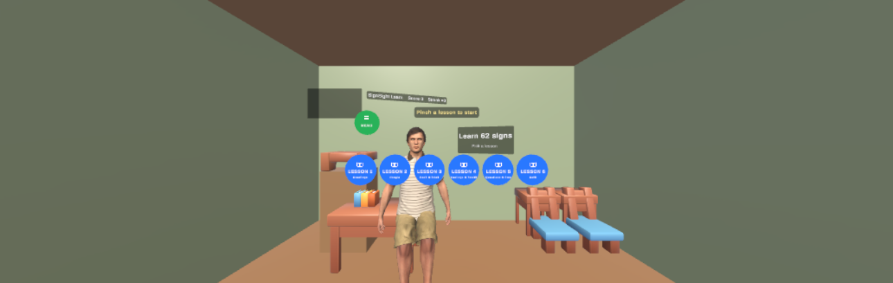
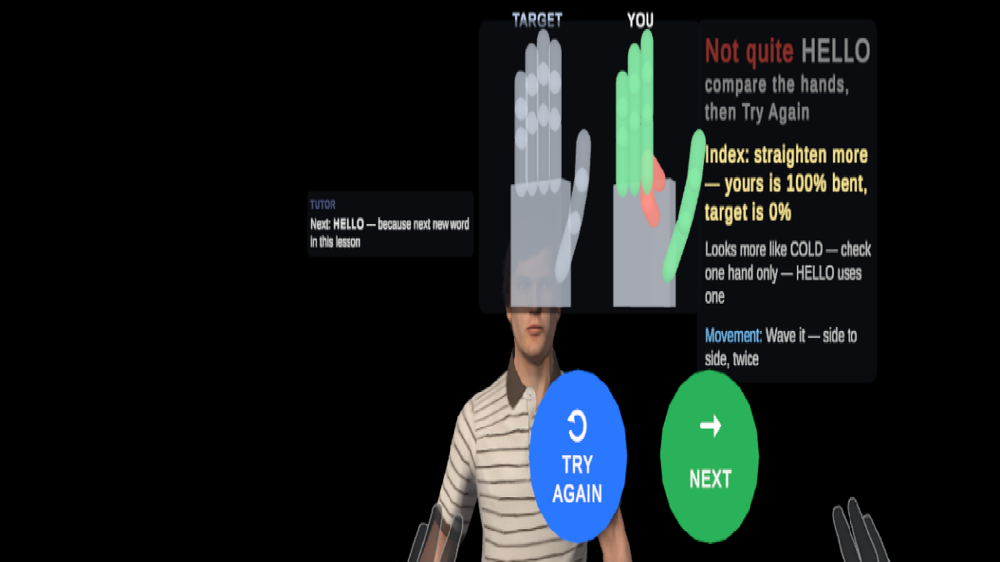
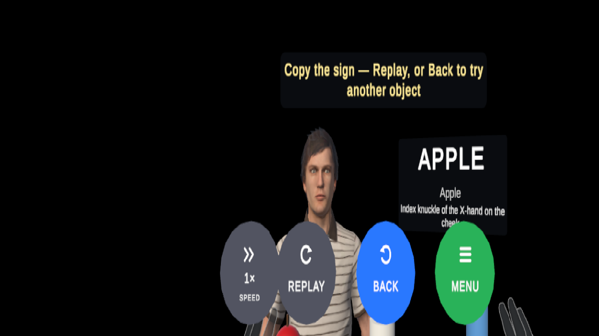
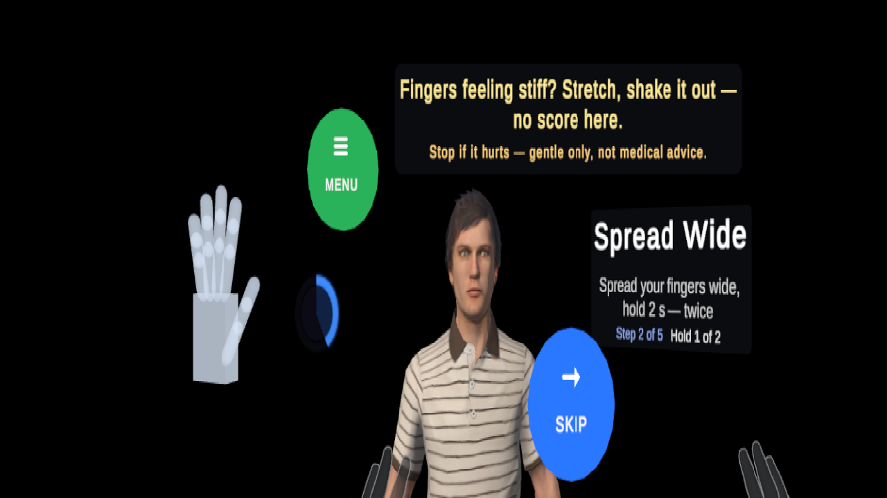
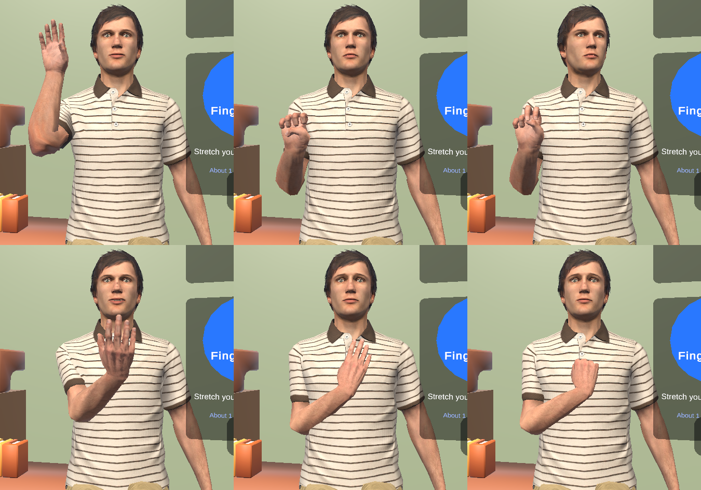
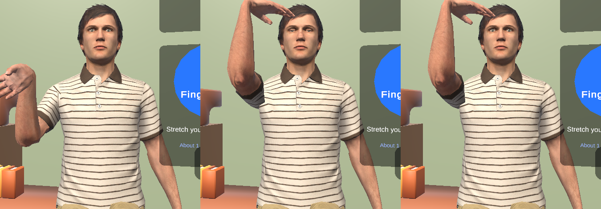
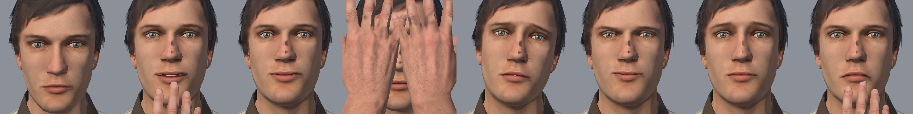

# SignSight Learn

Learn 62 **real ASL signs** for everyday life in mixed reality on Meta Quest 3 / 3S — greetings, people, food and
drink, feelings and health, questions and time, and a café. A 3D teacher sitting opposite you performs each sign — handshape,
location, movement, head and face — at normal or half speed; you copy it with your own hands within 3 seconds, and get
scored on handshape, start location and movement. When you are wrong, ghost hands show the target next to yours,
replay the movement at half speed, mark the fingers that are off, and say what to change.

## Why this matters

- **Most deaf children have hearing families.** About 9 in 10 deaf children are born to hearing parents
  (Mitchell & Karchmer, 2004). Parents, siblings, teachers and co-workers usually have to learn sign language as
  adults, often with nobody nearby to learn it from.
- **Sign language is 3D, and video is flat.** A sign is a handshape, a place on the body, a movement and a facial
  expression, all at once. From a flat video it is hard to see how deep a hand is, which way the palm faces, or which
  finger is bent. Here the teacher sits opposite you in 3D, and you can watch the sign from your own seat at half speed.
- **Self-study gives no feedback.** With a book or a video you cannot tell whether your own sign is right. Quest's
  hand tracking reads your hands, scores handshape, location and movement, and shows exactly what to change, such as
  "Index: straighten more" or "Move only the top hand".
- **Built so a Deaf or hard-of-hearing learner can use it.** Every instruction is a caption and nothing depends on
  sound. It is hands only, seated, with no controllers. No account and no network: the Tutor's memory stays on the
  headset.
- **Real signs, not a made-up alphabet drill.** All 62 words come from Lifeprint (ASL University) and are useful in
  everyday life. The café exam puts them together in a short real conversation.

## Screenshots

| | |
|---|---|
|  |  |
| **Feedback.** Your hand next to the target, the fingers that are off in red, and one clear hint. | **Café Final Exam.** The teacher is the clerk; you answer each question by signing. |
|  |  |
| **Explore.** Point at an object to see its word, and the teacher shows the sign. | **Finger Relax.** A one-minute stretch break, with no score. |

The first six signs of Lesson 1 at the end pose (HELLO, YES, NO, THANK-YOU, PLEASE, SORRY):

A sign from rest to the end pose (BOY: move, mid, hold):

The teacher's face is part of the sign (ASL is not hands only):

Screenshots are from the Unity Editor with Meta XR Simulator, not from a headset.

## What's in it

Four modes from the start screen: **Learn & Test** (the teacher shows a word, you copy it, it is scored) and
**Explore** (point at an object and hold 0.6 s; you see its English word and the teacher shows its sign — teaching only,
no score). On a headset Explore uses three virtual objects (apple, cup, bottle). In the Unity Editor it can instead run
on-device YOLOv9-t object detection (Unity Inference Engine, CPU, ~7 fps) on a mock camera frame and you point at the
detected boxes; the Quest passthrough camera path is a stub and its alignment is not validated. Objects outside the 62
words show "Not in my 62 words yet" and are never signed.

**Finger Relax** is a gentle ~1 minute stretch break for fingers that feel stiff after signing: open & close, spread
wide, finger piano, shake it out, wiggle & rest. A ghost hand shows each pose and a ring fills as you hold it; every
step also moves on by itself after a few seconds, so there is no score and nothing to fail. It can be started from the
start screen or, after a lesson, with RELAX on the lesson summary (then DONE starts the next lesson). Gentle only — stop
if it hurts; it is not medical advice.

**Final Exam — Café** puts the words to use: the teacher is the clerk behind a counter, signs each question (the
question is also on the card as text), and you answer by signing — greet him, say you want to order, pick a drink from
the menu (COFFEE / MILK / WATER), be polite, say hot or cold, say how many, say thank you. Seven answers, 70 points,
a fixed script — no free chat, no LLM. Each turn allows two tries (+10 / +5 / 0); HINT shows the answer but caps that
turn at +5; after a miss the clerk shows the sign once. The exam keeps its own score and stars and never changes the
lesson score or the Tutor's memory. Open from the start screen, or with EXAM on the Lesson 6 summary. The café is
props in a virtual café room (passthrough off): a counter, a round table with two chairs (KayKit Restaurant Bits, CC0),
a menu board and a cup. In Learn mode a few classroom props stand behind and beside the teacher (teacher desk, books,
shelf, two student desks and chairs — KayKit Furniture Bits, CC0 — and a blackboard panel); they are hidden in the
other modes.

**Rooms and passthrough (v3.8):** Learn and Exam are virtual rooms (passthrough off, with a short fade): the classroom
and the café, each with a floor, back and side walls and one light, built from plain shapes around the props above.
Start, Explore and Relax keep passthrough on, so you see your real room.

An on-device **Tutor Agent** decides what you practise next — a word you missed twice comes back at once, a finger you
keep getting wrong is the only one highlighted, words you have not seen for two lessons come back for review, words you
get right first time twice are shown less often — and shows its reason on screen ("Next: YES — because you missed it
twice / Focus: your index finger"). Rule-based, no network, no account.

The teacher also shows the face, because ASL is not hands-only: 23 of the 62 signs have a facial expression (WH-question
furrowed brows with a head tilt, SAD, HAPPY, PAIN, THANK-YOU's smile, ...), sourced from Lifeprint where it describes
one. The word card names what the brows, eyes and mouth do, and a FACE button replays just the face at half speed.
**The learner's face is never read or scored** — Quest 3 / 3S has no face tracking; every face line says
"Not scored — watch and copy". Correct answers get a silent confetti burst and stars; wrong answers get the ghost-hand
correction only.

Visual only, by design: the learner may be Deaf or hard of hearing. Every instruction is a caption; nothing depends on
sound. Hands only, seated, no controllers. Built for the Meta VR Start Developer Competition 2026 (Productivity, New
Experience).

## The 62 signs (definitions from Lifeprint / ASL University)

| Lesson | Signs |
|---|---|
| 1 Greetings | HELLO, YES, NO, THANK-YOU, PLEASE, SORRY, GOOD, BAD, GOODBYE, GOOD-MORNING* |
| 2 People | MOTHER, FATHER, FRIEND, BABY, MAN, WOMAN, BOY, GIRL, TEACHER*, DOCTOR |
| 3 Food & drink | WATER, MILK, EAT, DRINK, BREAD, APPLE, HUNGRY, THIRSTY, COFFEE, HOT |
| 4 Feelings & health | COLD, HELP, HAPPY, SAD, TIRED, SICK, PAIN, LOVE, LIKE, WANT |
| 5 Questions & time | NEED, WHAT, WHERE, WHEN, WHO, WHY, HOW, TODAY*, TOMORROW, GO |
| 6 Café | ME, YOU*, ONE, TWO, THREE, BIG, PAY*, MORE, FINISH, HERE*, MONEY*, HOW-MUCH* |

\* Practice only — not scored: compound signs (two beats with a handshape / location change), and in Lesson 6 signs
the recogniser cannot score fairly (directional PAY, two-handed circles of HERE, the opening hand of HOW-MUCH) or that
collided with an existing sign in the teacher self-test (YOU with GO, MONEY with BREAD). 54 signs are scored.
Every sign's Lifeprint source, handshape, location, movement and non-manual markers are in
`Assets/StreamingAssets/word_sources.json`. WH-question words show "Eyebrows: furrowed — watch the teacher (not scored)":
Quest 3 / 3S has no face tracking, so the face is never scored. ICED is not taught (fingerspelled in ASL).
Definitions follow Lifeprint (lifeprint.com, Dr. Bill Vicars); they have not been reviewed by Deaf signers yet —
corrections welcome.

## How it works

| Piece | Where |
|---|---|
| Hand features: curl per finger (bend angles between XR Hands joints) + palm direction | `Assets/Scripts/Hand/CurlCalculator.cs` |
| Both hands buffered in the signer's body frame; movement detectors: wave, wrist nod, snap, push, crank, flick, shake, lift (v3) and tap, stroke, circle, twist, turn, squeeze, converge, hold, rock (v3.1); start location = contact point (e.g. thumb tip) to a named body anchor (chin, forehead, chest, ...) | `Assets/Scripts/Hand/TrajectoryTracker.cs`, `SignScorerV31.cs`, `SignAnchors.cs` |
| Recognition: 0.4 handshape + 0.2 start location + 0.4 movement, 3 s attempt window, settle, 1 s lockout, Top1 / Top2 | `Assets/Scripts/Hand/SignRecognizer.cs` |
| Sign definitions (v2 schema: hands, curls, palm, movement, head, face) and the recorder that tunes them from your own hands | `Assets/Resources/templates.json`, `TemplateStore.cs`, `TemplateRecorder.cs`, `Assets/Scenes/TemplateRecorder.unity` |
| Teacher: both arms, fingers, head nod / shake and face (smile, blink) driven from the same definitions | `Assets/Scripts/Learn/TeacherAvatarDriver.cs`, `SignMotion.cs`, `FaceDriver.cs` |
| Lessons (6 lessons, 62 signs), scoring (+10 / +5 / streaks / stars), ghost-hand + movement feedback | `Assets/Scripts/Learn/` |
| Tutor Agent: perceive each attempt, remember per-word history on the headset (JSON), decide the next word, act with a specific hint and a visible reason | `Assets/Scripts/Learn/TutorAgent.cs`, `LearnerProfile.cs` |
| Lesson data, Lifeprint sources | `Assets/StreamingAssets/lessons.json`, `word_sources.json` |
| Offline teacher check against a sign-recognition model (dev machine only, nothing ships) | `workspace/goals/meta-vr-start-sign-language-entry/files/teacher-verification/` |

No image-recognition model and no third-party sign-language API: recognition is computed from Quest's hand joints.

## Third-party assets

- **Teacher character:** **Microsoft Rocketbox** avatar `Male_Adult_01` (facial version with 52 ARKit blendshapes),
  MIT License — https://github.com/microsoft/Microsoft-Rocketbox. Imported as a Unity Humanoid. We did not model it.
  Files: `Assets/Models/Rocketbox/`. `Assets/Editor/FixRocketboxMaxImport.cs` is a modified copy of the MIT import
  script from the same repository (scoped to that folder, Humanoid import; changes listed in its header).
- **Café props:** **KayKit Restaurant Bits 1.0** by Kay Lousberg (www.kaylousberg.com), CC0 1.0 — no attribution
  required — https://github.com/KayKit-Game-Assets/KayKit-Restaurant-Bits-1.0. Used: `kitchencounter_straight_A.fbx`,
  `table_round_A.fbx`, `chair_A.fbx` + the atlas texture, in `Assets/Models/Cafe/` with the pack's `LICENSE.txt`.
- **Classroom props:** **KayKit Furniture Bits 1.0** by Kay Lousberg, CC0 1.0 — no attribution required —
  https://github.com/KayKit-Game-Assets/KayKit-Furniture-Bits-1.0. Used: `table_medium.fbx`, `chair_A.fbx`,
  `shelf_A_small.fbx`, `book_set.fbx` + the atlas texture, in `Assets/Models/Classroom/` with the pack's `LICENSE.txt`.
  The blackboard and the café menu board are the project's own rounded panels. The cup is a Unity primitive.
- Meta XR All-in-One SDK v207, Unity OpenXR 1.18.0, Unity XR Hands 1.9.0, TextMeshPro.

## Honest notes

- **Not tested on a real Quest.** Development and testing used Meta XR Simulator v207 with laptop-webcam hand tracking.
  Thresholds (0.35 total distance, 3 s window, per-movement thresholds) are tuned in the simulator only. Two-handed
  signs suffer most from a single webcam (touching fists merge into one hand; ~30 cm depth jitter), so the editor uses
  a jitter allowance for COFFEE's "bottom hand still" check; device builds use the spec values.
- Quest 3 / 3S has no face tracking: the learner's face is never scored. The teacher's face is display only.
- **The 54 signs added after v3 have not been tried with real hands yet.** They pass a self-test (the teacher's own
  hands through the recogniser: 54 / 54 scored signs recognised, all 8 v3 signs included), which shows the teacher and
  the definitions agree — not that a learner's hands will be judged well.
- **The teacher's arm is computed, not motion-captured.** Elbow, forearm and wrist come from inverse kinematics with
  limits on where an elbow can go. The poses were judged by eye from still close-ups, not by a signer. Where Lifeprint
  gives no finger direction (BOY, APPLE), the direction was chosen so a human arm can reach it.
- **Replay of real human videos** (143 WLASL clips -> MediaPipe 3D hands -> the recogniser): 15 % of clips recognised.
  Video depth is 8-20 cm off and finger curls are rough, so this is a lower bound, not a headset prediction; it was used
  to fix four detector problems. Details: `teacher-verification/human_replay.md`.
- **Teacher check against a sign-recognition model (WLASL Pose-TGCN, asl1000, Top-5):** the teacher's sign was in the
  model's Top-5 for 11 of the 49 signs the model knows; the same model found 26 of 41 real human signers. For 13 signs the
  model also misses real humans (model unreliable for them); 22 signs need a human check of the teacher's demo; FRIEND's
  demo is simplified (the hands do not swap between the two links). Lifeprint is the reference; no definition was changed
  only because the model disagreed. Details: `teacher-verification/teacher_verification_50.md`.
- Not in this version: J / Z, R / U, M / N / T, the A–Z alphabet, continuous signing, two-way conversation.

## Running it

- Unity `6000.3.28f1`, URP, Android build target. Build: menu **SignSight → Build Quest APK** (`Builds/SignSightLearn.apk`).
- Simulator: activate Meta XR Simulator (Window → Meta → Meta XR Simulator → Activate), open `Assets/Scenes/Main.unity`,
  press Play, set Simulator inputs to Hand.
- Webcam hand tracking on this dev machine: the Simulator's built-in webcam service opens camera 0, which is a
  DroidCam virtual camera here. Start the service on the real webcam instead:
  `F:\MetaXRSimulator\webcam_tracking_server\webcam_tracking_server.exe --port 33797 --camera_index 2`
  (start it after enabling webcam tracking in the Simulator).
